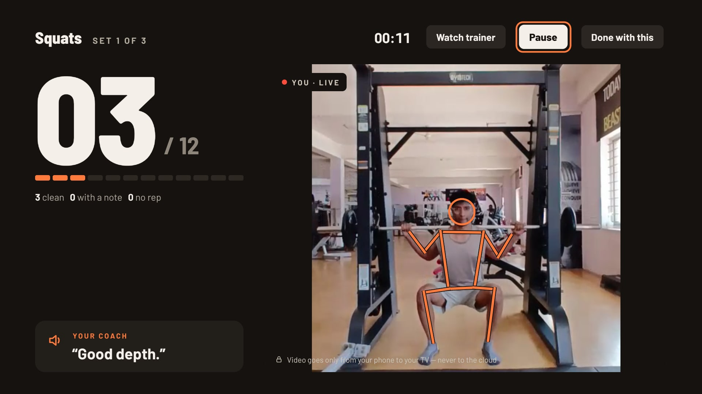
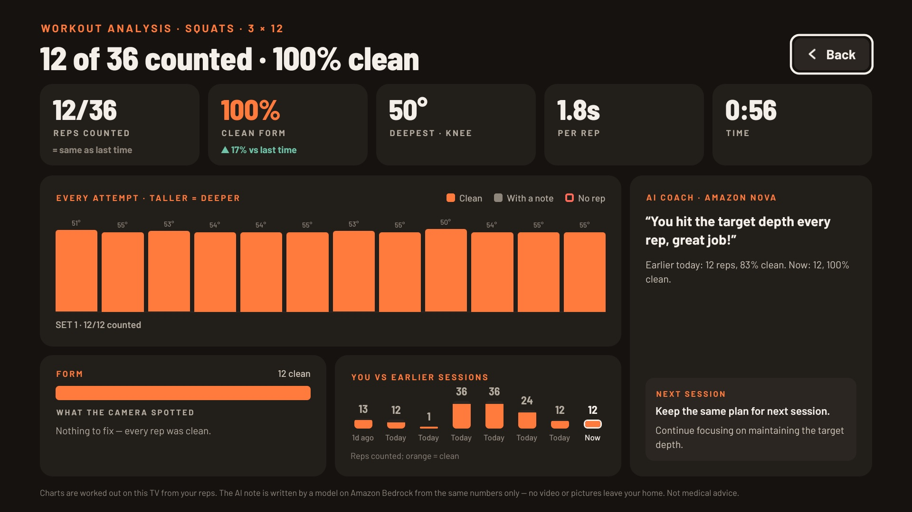
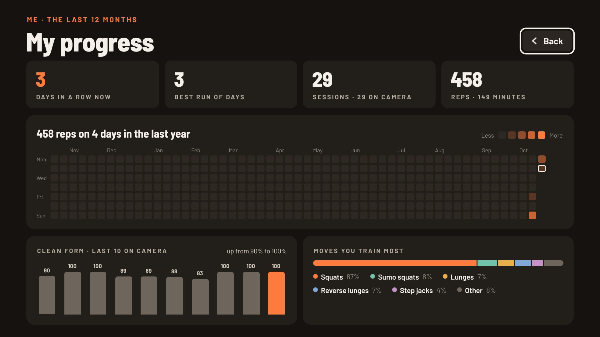
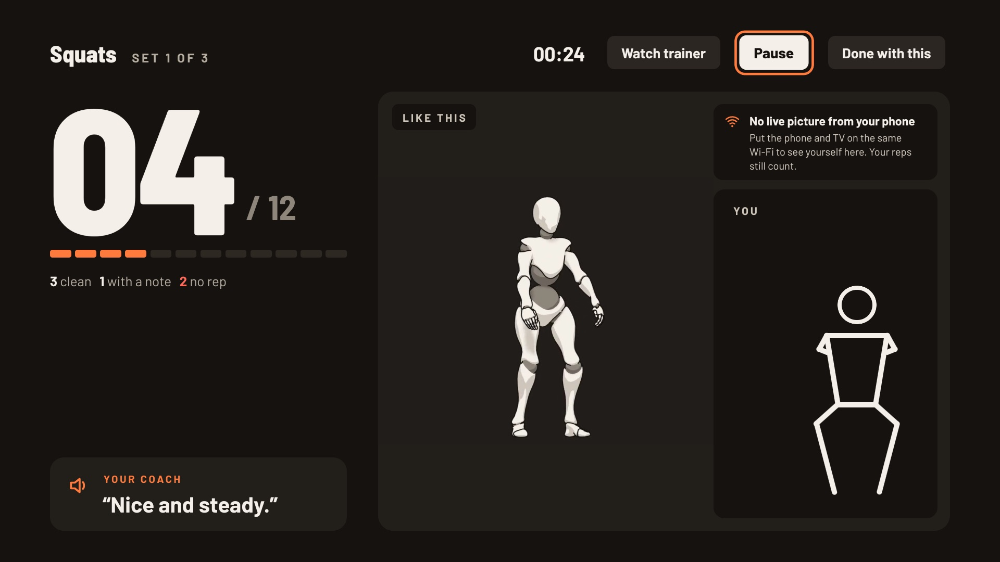
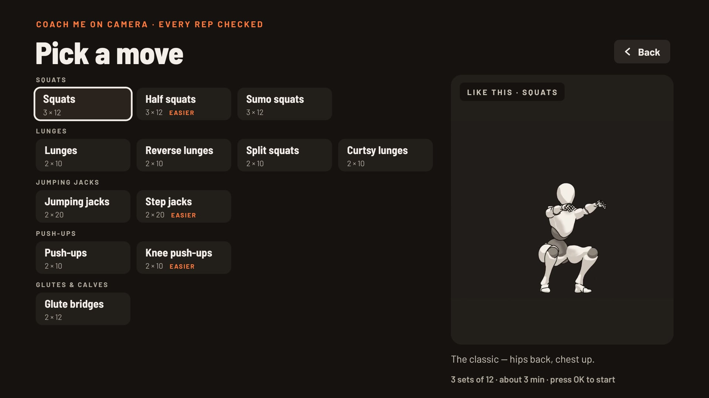
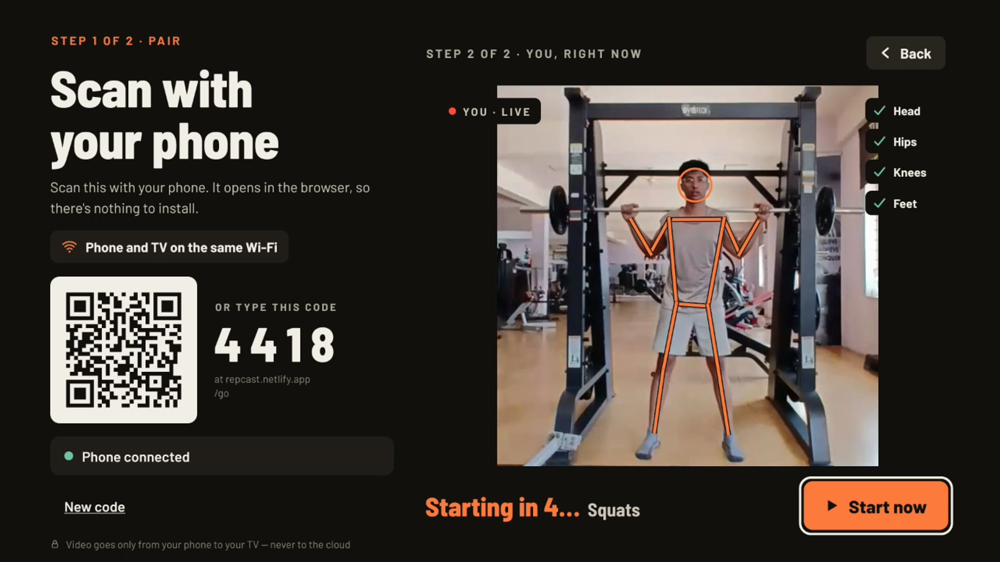

# RepCast

**The coach on your TV that sees every rep.** A Fire TV fitness coach that checks your form through the phone you already own — and calls out every rep like a coach in the room. Video goes only from your phone to your TV — never to the cloud.

- **Coach me on camera:** pick one of 12 moves the camera checks; your phone becomes the camera. It tracks your body with MediaPipe, judges every rep (good, needs a fix, or no rep — and why), and the TV shows your live picture with your skeleton drawn on it, the count, form notes, and a receipt at the end. Then pick another move — the phone stays linked.
- **Follow along:** pick any of 17 moves (planks and wall sits too) and follow a 3D trainer, a coach's voice and a tempo beat that counts the reps — no camera needed. Streaks and progress for everyone in the house.

> Built for **Build, Ship, Shape: Amazon Developer Hackathon 2026** — Fire TV track, plus the AWS Builder and Open Source mini challenges.

**Try it:** [phone camera page](https://mallikarjuntr.github.io/repcast-tv-app/) · [website](https://repcast.netlify.app) · [open-source engine](https://github.com/Mallikarjuntr/repcast-movement) · [how it's tested](docs/TESTING.md) · [friction log](docs/FRICTION.md)

**Built with:**         

## Why RepCast

- **Runs on the cheapest Fire TV.** Built and measured on a **Fire TV Stick 3rd gen: 32-bit Fire OS, about 1 GB of RAM** — live phone video, a skeleton over it at ~20 updates a second, voice and rep judging, using ~140–200 MB of memory with no low-memory kills in 10-minute soaks. Also runs on the Fire TV Stick 4K. Numbers in [TESTING §5–6](docs/TESTING.md).
- **No camera to buy.** The phone you already own does the watching: scan a QR code, nothing to install. Pose tracking runs *on the phone*; the video goes straight from phone to TV over your Wi-Fi — never to the cloud.
- **An honest coach.** Every rep is judged: clean, counted with a note, or **no rep — and why** ("Not low enough", "That's a lunge — this set is squats"). 12 moves, each told apart from its look-alikes (squat vs lunge, reverse vs forward lunge, step jack vs jumping jack) and checked from the front, 45° and the side.
- **Tested on real people and real footage**, not just demos: the user's own phone tests, gym and office clips, and public exercise videos, all replayed through the exact phone pipeline ([TESTING §9–12](docs/TESTING.md)). Friend's gym squats: 5 of 5 counted, and refused in a lunge set; gym split squats: 5 of 5 and 3 of 3.
- **Made for the living room.** Every screen works with the remote; a coach's voice (Amazon Polly) counts reps and says what to fix; profiles for everyone in the house, each with their own streak and history, kept on the TV.

## On a real Fire TV Stick

Screenshots from the Fire TV Stick, taken over ADB. The live picture is our own gym footage (filmed with a friend, who agreed to it), played through the phone page in place of the camera.

| | |
|---|---|
|  |  |
| **Live set:** your picture with the skeleton, count, verdicts and the coach's voice | **Workout analysis:** charts worked out on the TV, plus an AI coach's note from Amazon Nova on Bedrock |
|  |  |
| **Progress:** a year at a glance, per person | **No video?** The trainer shows the move, the outline still follows you, reps still count |
|  |  |
| **Pick a move:** 12 moves the camera checks | **Pair:** scan the QR code or type 4 digits |

## For judges

| Criterion | Where to look |
|---|---|
| **Technical implementation** | Phone ↔ TV over AppSync Events + WebRTC with a data channel for pose ([how it works](#how-it-works)); native-driven skeleton for a 1 GB stick ([friction #14](docs/FRICTION.md#14)); an open-source rep engine with 72 unit tests ([repcast-movement](https://github.com/Mallikarjuntr/repcast-movement)); replay bench + renders from three angles; infrastructure as code, deployed only by GitHub Actions with OIDC ([repcast-backend](https://github.com/Mallikarjuntr/repcast-backend)) |
| **Design** | One accent, big numbers, readable from the sofa; D-pad first; the TV leads and the phone follows; a 5-second countdown starts the set when you're in frame. Screenshots in [docs/screenshots](docs/screenshots/) |
| **Potential impact** | Turns any Fire TV + any phone into form coaching, with no hardware, account or subscription; privacy by design (video never leaves the home); free |
| **Quality of the idea** | Computer-vision fitness on Fire TV without a TV camera; multi-modal (phone camera + remote + voice + TV picture) in one flow |
| **AWS Builder** | AppSync Events (live link), API Gateway + Lambda + DynamoDB (pairing), Amazon Polly (all 117 coach lines, recorded in CI), Amazon Bedrock with Amazon Nova (workout analysis), Budgets, SAM/CloudFormation via GitHub OIDC — [why each](https://github.com/Mallikarjuntr/repcast-backend#readme) |
| **Open Source** | [repcast-movement](https://github.com/Mallikarjuntr/repcast-movement) (MIT): a separate library any app can use to count and judge reps from MediaPipe landmarks |
| **Friction log** | [docs/FRICTION.md](docs/FRICTION.md): 21 entries, each with task, steps, expected vs actual, severity, workaround and suggestion |

**What's real and what isn't:** everything in the demo is real and runs on a real Fire TV Stick, with the deployed backend. Test-only helpers are labelled as such: `tools/fake-phone.mjs` plays a phone's messages without a phone, and the camera page's `?src=` option plays a recorded clip instead of the camera.

## Repositories

| Repo | What's inside |
|---|---|
| [repcast-tv-app](https://github.com/Mallikarjuntr/repcast-tv-app) | Fire TV app + phone camera web app (this repo) |
| [repcast-backend](https://github.com/Mallikarjuntr/repcast-backend) | AWS stack (SAM): pairing API, live link (AppSync Events), coach voice (Polly) — deployed by GitHub Actions |
| [repcast-movement](https://github.com/Mallikarjuntr/repcast-movement) | Open-source movement engine: rep and hold detection and form checks from pose landmarks |

## How it works

```
Phone (web page, camera)                       AWS                          Fire TV (React Native)
MediaPipe pose ─▶ repcast-movement ─ reps ──▶ AppSync Events channel ──▶ rep count, verdicts, receipt
        │                                       (pairing via 4-digit code)
        └─ camera video + pose points ── WebRTC, straight over home Wi-Fi ──▶ live picture + skeleton
```

1. The TV asks the backend for a 4-digit code and shows it with a QR code.
2. The phone opens the camera page from the QR code (nothing to install), links to the TV, and runs pose tracking and rep judging on the phone.
3. Reps, verdicts and framing go to the TV over an AppSync Events channel. The camera picture and pose points go straight from phone to TV over WebRTC on the home Wi-Fi; the set-up messages for that connection use the same channel.

## What's in this repo

| Path | What |
|---|---|
| `apps/tv` | Fire TV app: Expo SDK 57 + [react-native-tvos](https://github.com/react-native-tvos/react-native-tvos) 0.86, react-native-webrtc |
| `apps/camera` | Phone camera web app: TypeScript + Vite, MediaPipe Pose Landmarker, hosted on GitHub Pages |
| `packages/shared` | What the phone and TV share: message types, backend endpoints, the AppSync Events client |
| `tools/fake-phone.mjs` | Plays the phone's side of a workout against the real backend, to test the TV without a phone |
| `tools/trainer` | Blender scripts that render the 3D trainer clips ([how](tools/trainer/README.md)) |
| `tools/voice` | Coach voice lines (recorded with Amazon Polly by the backend) |
| `tools/brand` | App icon, TV banner and Appstore images ([how](docs/store/README.md)) |
| `docs/` | [How it's tested](docs/TESTING.md), [friction log](docs/FRICTION.md), screenshots |

## Run it

Tested on **macOS (Apple silicon)**. On **Windows**, use WSL 2 (Ubuntu) and run the same commands; the Fire TV build also works from PowerShell with the environment variables set as `$env:EXPO_TV=1; $env:CI=1` (not tested by us). Easiest of all: no build needed to try the phone side — open the published camera page.

You need **Node.js 24** and npm. Install everything once from the repo root:

```bash
npm ci
```

The apps use the deployed RepCast backend out of the box (public endpoints in `packages/shared/src/config.ts`), so there is nothing to configure. To run your own backend, deploy [repcast-backend](https://github.com/Mallikarjuntr/repcast-backend) and put its stack outputs in that file.

### Phone camera app

The published version is at **https://mallikarjuntr.github.io/repcast-tv-app/**. The TV's QR code opens the short link **https://repcast.netlify.app/go?code=…** on the [website](https://github.com/Mallikarjuntr/repcast-tv-landing-page), which opens the same page at **https://repcast.netlify.app/camera/** (Netlify serves it from GitHub Pages, so it is still built and published from here).

To run it locally:

```bash
npm run dev:camera      # http://localhost:5173
npm run build:camera    # production build in apps/camera/dist
```

Browsers only allow the camera on HTTPS pages or on `localhost`, and the backend only accepts the published site and `localhost:5173` / `:4173`, so to test with a real phone use the published site.

Page options (add to the URL): `?code=1234` links to that TV, `?model=full` uses the larger pose model, `?video=off` turns off the video to the TV, and `?src=<video url>` replays a recorded exercise clip instead of the camera (the clip's host must allow CORS, as Wikimedia Commons does) — handy for testing the TV without exercising.

### Fire TV app

You need **JDK 17** and the **Android SDK** (platform 36, build-tools 36). The app is Android-only.

```bash
cd apps/tv
EXPO_TV=1 CI=1 npx expo prebuild --platform android --clean --no-install   # generates android/
cd android
EXPO_TV=1 NODE_ENV=production ./gradlew assembleRelease -PreactNativeArchitectures=armeabi-v7a,arm64-v8a
```

The APK is `apps/tv/android/app/build/outputs/apk/release/app-release.apk`. Keep `armeabi-v7a` in the list: Fire TV Sticks like the 3rd gen run a 32-bit Fire OS and can't install a 64-bit-only build.

**Install on a Fire TV:** turn on *Settings → My Fire TV → Developer Options → ADB debugging* (if Developer Options is hidden, open *About* and select the device name seven times), find the TV's IP address (*Settings → My Fire TV → About → Network*), then:

```bash
adb connect <fire-tv-ip>:5555        # accept the prompt on the TV
adb install -r app/build/outputs/apk/release/app-release.apk
```

RepCast then appears in the Fire TV's apps list. It also runs on the Android TV emulator.

### Try a coached workout

1. On the TV: **Start → Coach me on camera → pick a move** (squats, lunges, jumping jacks, push-ups or glute bridges, each with an easier version). The TV shows a QR code and a 4-digit code.
2. On a phone **on the same Wi-Fi as the TV**: scan the QR code (or open the camera page and type the code) and allow the camera. The camera starts by itself (on some browsers, tap **Start camera**).
3. Prop the phone at hip height about 2–3 m away, turned about 45°, and step back until the TV ticks what it needs. The TV counts down from 5 and starts by itself (or press **Start now**).
4. The TV runs the move and keeps the count; the phone shows the same count, set and rest, and the TV does the talking. **Done with this** ends the move early. On the receipt, **Another move** goes back to the list with the phone still linked — no new code.

No phone handy? `node tools/fake-phone.mjs <code> --start-after 8 --rest 32` plays a scripted 3 × 12 squat session against the code on the TV (no video). Or open the camera page on a computer with `?code=<code>&src=<clip url>` to send a recorded squat, with video, to the TV.

## Tests

```bash
npm run build:camera                      # typecheck + build the camera app (what CI runs)
cd apps/tv && npx tsc --noEmit            # typecheck the TV app
```

The rep engine has its own unit tests in [repcast-movement](https://github.com/Mallikarjuntr/repcast-movement) (`npm test`), and `apps/camera/replay.html` replays recorded videos through the exact phone pipeline (`&repeat=N` loops a clip). `tools/trainer/views.py` renders every judged move from the front, 45° and the side to check the judging wherever the phone stands. Results, device measurements and known limits are in [docs/TESTING.md](docs/TESTING.md).

## License

MIT
